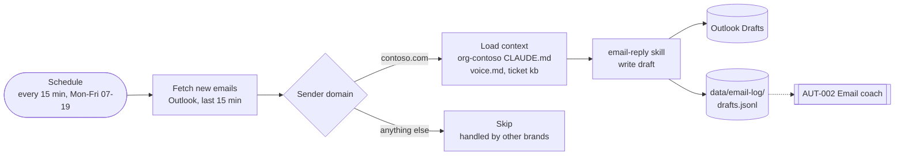

# AUT-001 Email agent (org-contoso)

Drafts replies to new Contoso emails in my voice. Saves drafts only; I review and send.



## Run command

```bash
cd ~/master-os/brands/org-contoso && claude -p "/email-reply brand=org-contoso mode=inbox-sweep" \
  --add-dir ../../context \
  --permission-mode dontAsk --permission-prompts none \
  --allowedTools "Edit(./data/email-log/**),<outlook read and create-draft tools>"
```

- **Starting in the brand folder is the silo.** Claude can read the brand and `context/` (added with `--add-dir`) without asking. In `dontAsk` mode a read anywhere else is denied, so other brands and `clients/` are out of reach. Shared skills still load from the root `.claude/skills/`.
- **No send tool is on the list,** so the run can't send mail even if it tries.
- Run `/mcp` to get the exact Outlook tool names on your machine.
