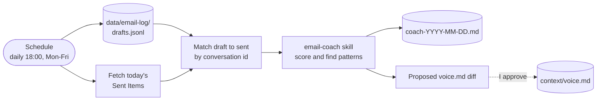

# AUT-002 Email coach (org-contoso)

Compares each draft from AUT-001 with what I actually sent, and proposes changes to my voice rules.



## Run command

```bash
cd ~/master-os/brands/org-contoso && claude -p "/email-coach brand=org-contoso" \
  --add-dir ../../context \
  --permission-mode dontAsk --permission-prompts none \
  --allowedTools "Edit(./data/email-log/**),<outlook read tools>"
```

`context/voice.md` isn't in the edit list, so the coach can only propose changes. Applying them is my call.
