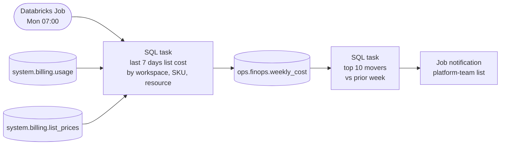

# AUT-003 Weekly Databricks cost report (org-contoso)

A deterministic Databricks Job. Claude helped build it with the `cost-review` skill, but no LLM runs at run time.

## Details

- **Code:** `~/work/contoso/finops-jobs` (Azure DevOps), deployed with Databricks Asset Bundles
- **Query:** based on `.claude/skills/cost-review/sql/dbx_cost_by_resource.sql`
- **Runs as:** `sp-finops-reader` (USE and SELECT on `system.billing`; write only on `ops.finops`)
