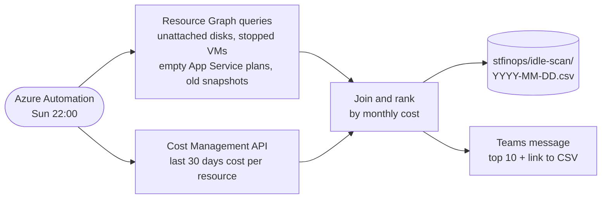

# AUT-004 Idle Azure resource scan (org-contoso)

A deterministic Azure Automation runbook. It finds idle and orphaned resources. It reports only and never deletes.

## Details

- **Code:** `~/work/contoso/finops-jobs/runbooks/idle_scan.py`
- **Runs as:** managed identity `mi-idle-scan` (Reader and Cost Management Reader on both subscriptions)
