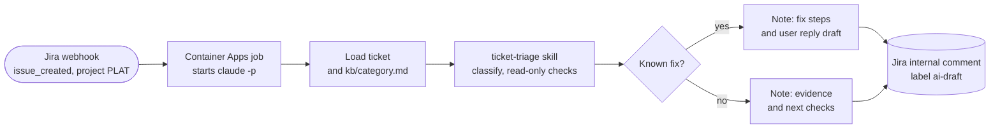

# AUT-005 Ticket triage (org-contoso, pilot)

When a new PLAT ticket is created, it drafts an internal triage note on the ticket. A person replies to the user.



## Run command (inside the job container)

```bash
cd /app/master-os/brands/org-contoso && claude -p "/ticket-triage ticket=$JIRA_KEY" \
  --add-dir ../../context \
  --permission-mode dontAsk --permission-prompts none \
  --allowedTools "Bash(databricks jobs get-run *),<jira comment tool>"
```

- `ticket-triage` is an org-only skill, so the run has to start in `brands/org-contoso` for the skill to load.
- The Jira token comes from Key Vault at start-up. The run has no write access to Azure or Databricks.
