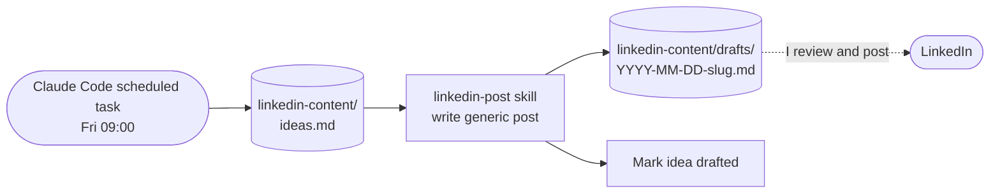

# AUT-006 LinkedIn draft from cost tips (personal)

Every Friday, it turns the top idea into a post draft. I edit and post by hand.

## Details

- **Reads:** `brands/personal/**` only. It has no connector and no org or client access.
- **Writes:** `drafts/` and `ideas.md`. It commits to the repo, and I review the diff.
