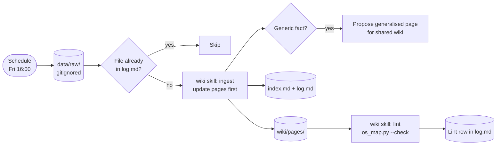

# AUT-007 Wiki ingest and lint (org-contoso)

Every Friday it ingests the week's new raw sources (postmortems, meeting notes, ticket exports) into the Contoso wiki, then lints it.



## Run command

```bash
cd ~/master-os/brands/org-contoso && claude -p "/wiki ingest brands/org-contoso/wiki" \
  --add-dir ../../wiki \
  --permission-mode dontAsk --permission-prompts none \
  --allowedTools "Edit(./wiki/**)"
```

- It reads the shared schema through `--add-dir`, but can only edit the Contoso wiki. Promoting a fact to the shared wiki stays a proposal that I apply.
- Raw sources are gitignored, so this runs on the laptop, not as a cloud task.
